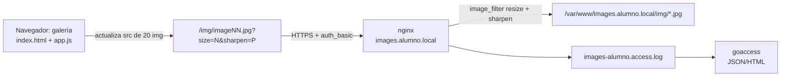

# AE3 — Galería con procesado de imágenes, módulos y HTTPS

## 1. Instalación

El módulo `image_filter`, ImageMagick y GoAccess los instalé anteriormente en `dpl-lab` durante la práctica guiada de módulos de nginx.

Para instalar y activar `image_filter` utilicé:

```bash
docker exec dpl-lab apt-get update
docker exec dpl-lab apt-get install -y libnginx-mod-http-image-filter
docker exec dpl-lab ls /etc/nginx/modules-enabled/
docker exec dpl-lab grep -R "load_module" /etc/nginx/modules-enabled/
docker exec dpl-lab nginx -t
```

También instalé ImageMagick para generar y comprobar las imágenes y GoAccess para analizar los logs.

Al comenzar esta práctica comprobé que seguían disponibles:

```bash
nginx -V
convert -version
goaccess --version
```

Obtuve estas versiones:

```text
nginx/1.24.0 (Ubuntu)
ImageMagick 6.9.12-98
GoAccess 1.8.1
```

En la salida de `nginx -V` también apareció:

```text
--with-http_image_filter_module=dynamic
```

Después comprobé que nginx cargaba el módulo:

```bash
cat /etc/nginx/modules-enabled/50-mod-http-image-filter.conf
```

La salida mostró:

```text
load_module modules/ngx_http_image_filter_module.so;
```

Por tanto, comprobé que `image_filter` seguía instalado y activo.

## 2. Generación de las imágenes

Las 20 imágenes de prueba las generé dentro de `dpl-lab` con ImageMagick.

Primero comprobé que ImageMagick seguía instalado y después creé la carpeta donde se guardan las imágenes:

```bash
docker exec dpl-lab apt-get install -y imagemagick
docker exec dpl-lab mkdir -p /var/www/images.alumno.local/img
```

Las generé como se indica en la práctica de `image_filter`:

```bash
docker exec dpl-lab bash -c 'for i in $(seq -w 1 20); do \
  convert -size 400x400 gradient:"#2f6fed"-"#8bc34a" \
    -fill white -pointsize 64 -gravity center -annotate 0 "IMG $i" \
    /var/www/images.alumno.local/img/image$i.jpg; done'
```

Y para comprobarlo:

```bash
docker exec dpl-lab identify /var/www/images.alumno.local/img/image01.jpg
```

Obtuve la salida:

```text
/var/www/images.alumno.local/img/image01.jpg JPEG 400x400 400x400+0+0 8-bit sRGB 12679B 0.000u 0:00.000
```

Las imágenes de prueba no se incluyen en el repositorio, ya que se pueden volver a generar con el comando anterior.

## 3. Configuración

Para configurar `images.alumno.local` seguí los pasos de la práctica guiada de `image_filter`.

Primero generé un certificado autofirmado para `images.alumno.local` y `www.images.alumno.local`:

```bash
docker exec dpl-lab openssl req -x509 -nodes -newkey rsa:2048 -days 365 \
    -keyout /etc/ssl/dpl/images.alumno.local.key \
    -out /etc/ssl/dpl/images.alumno.local.crt \
    -subj "/CN=images.alumno.local" \
    -addext "subjectAltName=DNS:images.alumno.local,DNS:www.images.alumno.local"
```

La clave privada se quedó en `/etc/ssl/dpl/` y solo guardé en el proyecto el certificado público y las instrucciones de generación.

Después creé el usuario que protege las imágenes:

```bash
docker exec dpl-lab bash -c 'echo "alumno:$(openssl passwd -apr1 CAMBIAR_ESTO)" > /etc/nginx/htpasswd-images'
```

El fichero de usuarios se guarda fuera del DocumentRoot.

Por último configuré el server block de `images.alumno.local`.

En la configuración utilicé `map` para limitar los valores permitidos de tamaño, enfoque y calidad. También configuré:

- HTTPS en el puerto 443.
- `image_filter` dentro de `/img/`.
- autenticación básica en `/img/`.
- redirección de HTTP a HTTPS.
- redirección de `www.images.alumno.local` a `images.alumno.local`.
- logs propios para el sitio.

Después activé el sitio y comprobé la configuración:

```bash
docker exec dpl-lab nginx -t
```

La comprobación terminó correctamente.

## 4. La aplicación

Para crear la galería reutilicé el código del Paso 4 de la práctica guiada de `image_filter`.

Copié los archivos necesarios en la carpeta `web/`:

```text
index.html
app.js
estilos.css
```

Después los copié al directorio `/var/www/images.alumno.local/` para que nginx pudiera servir la aplicación:

```bash
docker exec dpl-lab bash -c 'cp /home/alumno/dpl/ae3/web/index.html /home/alumno/dpl/ae3/web/app.js /home/alumno/dpl/ae3/web/estilos.css /var/www/images.alumno.local/'
docker exec dpl-lab chmod -R a+rX /var/www/images.alumno.local
```

La aplicación crea 20 imágenes y dispone de cinco campos:

- tamaño;
- ancho del borde;
- color del borde;
- enfoque;
- desenfoque.

Al pulsar el botón `Generar`, `app.js` actualiza el `src` de las 20 imágenes utilizando una URL como:

```text
/img/image01.jpg?size=150&sharpen=30
```

El tamaño y el enfoque se envían en la URL para que nginx los procese con `image_filter`.

El ancho del borde, el color y el desenfoque se aplican directamente en el navegador.

### Reparto entre cliente y servidor

`image_filter` solo aplica transformaciones como `resize`, `crop`, `rotate`, `sharpen` y calidad; no soporta bordes, colores ni desenfoque.

Por eso la galería aplica el borde y su color con CSS y el desenfoque con `filter: blur(...)`, mientras que el tamaño y el enfoque viajan en la URL hasta nginx.

Un módulo de terceros como `ngx_small_light` sí permitiría bordes y desenfoque en el servidor, pero requiere compilarlo contra la versión exacta de nginx. Es una ampliación opcional y no probada en este curso.

### Diagrama



## 5. Comprobación

Realicé las comprobaciones indicadas en la tarea y guardé las salidas completas en `comprobaciones.txt`.

Primero comprobé la configuración de nginx y que el módulo `image_filter` estaba cargado:

```bash
docker exec dpl-lab nginx -t
docker exec dpl-lab nginx -T | grep -E "server_name|image_filter|auth_basic|load_module"
docker exec dpl-lab nginx -V 2>&1 | grep image_filter
```

La configuración terminó correctamente y se comprobó que `image_filter` estaba cargado y utilizado en `/img/`.

Después comprobé el funcionamiento del sitio:

```bash
docker exec dpl-lab curl -k -I https://localhost/ -H "Host: images.alumno.local"
```

La página principal respondió:

```text
HTTP/1.1 200 OK
```

Al intentar acceder a una imagen sin credenciales:

```bash
docker exec dpl-lab curl -k -I https://localhost/img/image01.jpg -H "Host: images.alumno.local"
```

obtuve:

```text
HTTP/1.1 401 Unauthorized
```

Después descargué una imagen autenticándome y solicitando tamaño `150` y enfoque `30`:

```bash
docker exec dpl-lab curl -k -u alumno:CAMBIAR_ESTO -o /tmp/ae3.jpg \
    "https://localhost/img/image01.jpg?size=150&sharpen=30" \
    -H "Host: images.alumno.local"
```

Comprobé el tamaño con:

```bash
docker exec dpl-lab identify /tmp/ae3.jpg
```

La salida fue:

```text
/tmp/ae3.jpg JPEG 150x150 150x150+0+0 8-bit sRGB 2451B 0.000u 0:00.000
```

También comprobé la redirección de `www.images.alumno.local`:

```bash
curl -I -H "Host: www.images.alumno.local" http://localhost/
```

La respuesta fue:

```text
HTTP/1.1 301 Moved Permanently
Location: https://images.alumno.local/
```

Por último generé un informe con GoAccess:

```bash
docker exec dpl-lab goaccess /var/log/nginx/images-alumno.access.log --log-format=COMBINED -o /tmp/ae3.json
docker exec dpl-lab head -c 400 /tmp/ae3.json
```

El informe se generó correctamente a partir del log del sitio.

## 6. Problemas encontrados

Al ejecutar `nginx -T` desde dentro del contenedor como usuario `alumno`, nginx no pudo leer la clave privada del certificado:

```text
cannot load certificate key "/etc/ssl/dpl/images.alumno.local.key":
BIO_new_file() failed
Permission denied
```

La clave privada tenía permisos restringidos y el usuario `alumno` no podía leerla.

En lugar de cambiar los permisos de la clave privada, salí del contenedor y repetí la comprobación desde el anfitrión, ejecutando nginx como `root` dentro de `dpl-lab`:

```bash
docker exec dpl-lab nginx -T
```

De esta forma la comprobación funcionó correctamente sin modificar los permisos de la clave privada.

## 7. Repositorio remoto

El proyecto está disponible en:

https://github.com/OOramas/ae3
